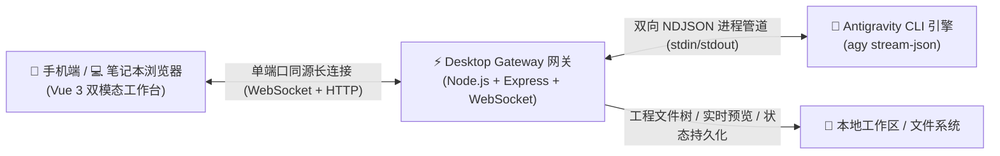

# Antigravity Web Remote 远程控制套件 (IDEagy-Remote)

<p align="center">
  <a href="./README_EN.md"><b>English</b></a> | <a href="./README.md"><b>简体中文</b></a>
</p>

<p align="center">
  <a href="https://github.com/SimonChen-86/IDEagy-Remote/releases"></a>
  <a href="https://github.com/SimonChen-86/IDEagy-Remote/releases"></a>
  
  
  <a href="./LICENSE"></a>
  
</p>

---

一套专为 **Google Antigravity IDE** 量身打造的高颜值、轻量级、跨平台双模态远程 Web 控制工作台。由 **Simon Chen** 架构设计与研发。无需复杂配置，让开发者利用局域网或公网，通过手机浏览器、平板或笔记本电脑，随时随地掌控 Antigravity 智能体编程、实时观测深度思维链、在线预览代码成果，并在移动端安全审批指令。



界面与功能预览：<br>


---

## 📖 背景说明

> *（本章节保留，待后续补充）*

---

## 📥 交付物一键下载与快速安装 (GitHub Releases)

本项目所有跨平台发布包均为**开箱即用绿色版**（内置免安装独立 Node.js 运行时，无需宿主机配置复杂环境）：

| 平台 / 操作系统 | 下载链接 | 推荐启动方式 |
| :--- | :--- | :--- |
| **Windows (x64)** | [IDEagy-Remote-v0.1.10-windows-x64.zip](https://github.com/SimonChen-86/IDEagy-Remote/releases/latest) | 解压后双击运行 `ideagy.bat` |
| **Linux (x64)** | [IDEagy-Remote-v0.1.10-linux-x64.tar.gz](https://github.com/SimonChen-86/IDEagy-Remote/releases/latest) | 解压后终端执行 `./ideagy.sh` |
| **macOS (Apple Silicon)** | [IDEagy-Remote-v0.1.10-darwin-arm64.tar.gz](https://github.com/SimonChen-86/IDEagy-Remote/releases/latest) | 解压后终端执行 `./ideagy.sh` |
| **完整性校验** | [SHA256SUMS.txt](https://github.com/SimonChen-86/IDEagy-Remote/releases/latest) | `certutil -hashfile <文件> SHA256` |

> 💡 **绿色包使用提示**：日常使用请直接下载上方表格中的便携包，解压即用；GitHub Releases 底部的 `Source code` 仅包含使用说明文档。

---

## ⚡ 快速上手操作手册

只需简单几步，即可享受远程掌控 Antigravity 智能体的极速开发体验：

### 1. 一键启动网关
- **Windows**：双击解压目录中的 `ideagy.bat`（或其桌面快捷方式）；
- **Linux / macOS**：在终端进入解压目录，执行 `./ideagy.sh`。
- 启动成功后，终端将输出访问引导信息，例如：
  ```text
  ================================================================
     🎉 Antigravity Web Remote 控制台已成功启动！
  ================================================================
  📌 本地访问:    http://localhost:3000/
  🌐 局域网访问:  http://192.168.1.108:3000/
  🔒 访问密码:    antigravity  (出厂默认密码)
  ================================================================
  ```

### 2. 浏览器连接与登录
- 在手机、平板或笔记本浏览器中打开终端提示的地址（如 `http://192.168.1.108:3000/`）；
- 输入出厂预设密码 `antigravity`，点击进入（自动记录 7 天免登凭证，后续访问无需重复输入）。

### 3. 选择工程与智能体对话
- **选择工程**：在左侧面板直接点选“常用置顶”项目，或选择自动探测到的本地 Antigravity IDE 最近活跃工程；
- **自然交互**：在底部输入框输入您的编程需求，也可以直接点击便捷提示词（如【查Bug】、【开始编码】、【继续】）；
- **洞察思维**：实时查看 **ThinkingBox 深度思维链**，展开/折叠智能体推理逻辑与工具执行过程；
- **成果即时看**：右侧面板（或手机底部抽屉）实时预览生成的代码文件、渲染 Markdown 与体验 HTML 原型。

### 4. 双模态自适应切换 (📱 手机模式 vs 💻 桌面工作台)
- 点击页面顶栏右上角的**模态切换按钮**，可在两种体验间一键秒切：
  - **📱 手机紧凑模式 (`< 768px`)**：大拇指触控流、单列聊天瀑布、滑出式预览抽屉，完美适配移动设备；
  - **💻 桌面工作台模式 (`>= 768px`)**：专业三栏 IDE 视图（工程导航 + 核心对话 + 多格式成果实时预览）。

### 5. 个性化偏好与设置 (⚙️ Settings)
- 点击顶栏或侧边栏的**设置图标**：
  - **修改密码**：自定义您的专属 Web 访问控制密码；
  - **模型配置**：自由切换底层 AI 模型（如 `gemini-3.8-flash` 等）以及深度思考等级；
  - **快捷提示词**：可按需自由新增、编辑常用的快速发送指令。

---

## 🌟 核心亮点

- **纯原生零依赖跨平台 (No Docker, No Database)**：基于轻量 Node.js LTS 运行时，免除 Docker 容器与关系数据库依赖，解压即用。
- **同源单端口安全托管 (Same-Origin Hosting)**：单一端口（默认 `3000`）同时承载 Web 页面静态托管与 WebSocket 全双工通信，无跨域阻碍。
- **双模态自适应工作台 (Mobile & Desktop Dual-Mode)**：随时在手机大拇指单列触控模式与桌面专业三栏 IDE 工作台间无缝切换。
- **多格式文件与成果实时预览 (PreviewPanel)**：内置 Markdown 渲染、HTML 沙箱交互、代码高亮一键复制及图片/PDF 查看。
- **工程热休眠与会话记忆恢复 (Restore Session)**：工作区闲置 20 分钟自动释放后台子进程，点击【恢复上次会话】秒级唤醒对话记忆。

---

## 📚 官方文档导航

| 文档名称 | 核心内容说明 | 直达链接 |
| :--- | :--- | :---: |
| **📖 用户详细操作指南** | 密码管理、模型配置、权限审批卡片交互、移动端与常见问答 (FAQ) | [USER_GUIDE.md](./docs/USER_GUIDE.md) |
| **🚀 部署与运维实操指南** | 防火墙与局域网放行、反向代理与 HTTPS 配置、公网安全穿透、开机自启 | [DEPLOYMENT_GUIDE.md](./docs/DEPLOYMENT_GUIDE.md) |

---

## 📄 许可证与分发声明 (License & Distribution)

本项目为**免费专有软件 (Freeware)**，仅向公众公开发布编译压制好的 Releases 独立便携运行包及配套使用文档。

- **免费使用**：允许个人开发者与团队免费下载并用于日常远程开发与控制台交互；
- **闭源声明**：本项目源代码暂未开源，保留所有专有权利（All Rights Reserved）。未经作者书面授权，严禁对发布交付物进行反编译、逆向工程、篡改重构、二次打包或商业化倒卖；
- **版权归属**：Copyright (c) 2026 Simon Chen. All rights reserved.
