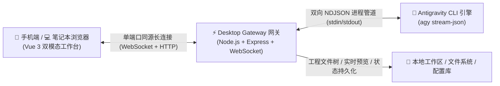

# Antigravity Web Remote 远程控制套件 (IDEagy-Remote)

<p align="center">
  <a href="https://github.com/SimonChen-86/IDEagy-Remote/releases"></a>
  <a href="https://github.com/SimonChen-86/IDEagy-Remote/releases"></a>
  
  
  <a href="./LICENSE"></a>
  
</p>

---

一套专为 **Google Antigravity IDE** 量身打造的高颜值、轻量级、跨平台双模态远程 Web 控制工作台。由 **Simon Chen** 架构设计与研发，让开发者利用开发机公网 IP 或局域网，通过手机浏览器、平板或笔记本电脑 Chrome，随时随地掌控 Antigravity 智能体编程、流式观测模型深度思考链路、实时多格式渲染成果预览，并在 Web 端安全审批高危指令。



---

## 📥 交付物一键下载与快速安装 (GitHub Releases)

本项目所有跨平台发布包均为**开箱即用绿色版**（内置免安装独立 Node.js 运行时，无需宿主机配置编译链）：

| 平台 / 操作系统 | 下载链接 | 推荐启动方式 |
| :--- | :--- | :--- |
| **Windows (x64)** | [IDEagy-Remote-v0.1.8-windows-x64.zip](https://github.com/SimonChen-86/IDEagy-Remote/releases/latest) | 双击运行 `ideagy.bat` |
| **Linux (x64)** | [IDEagy-Remote-v0.1.8-linux-x64.tar.gz](https://github.com/SimonChen-86/IDEagy-Remote/releases/latest) | 终端执行 `./ideagy.sh` |
| **macOS (Apple Silicon)** | [IDEagy-Remote-v0.1.8-darwin-arm64.tar.gz](https://github.com/SimonChen-86/IDEagy-Remote/releases/latest) | 终端执行 `./ideagy.sh` |
| **完整性校验** | [SHA256SUMS.txt](https://github.com/SimonChen-86/IDEagy-Remote/releases/latest) | `certutil -hashfile <文件> SHA256` |

> ⚠️ **交付物与源码说明**：  
> 1. 本项目为免费专有软件 (Freeware)，核心业务源码采用闭源沙盒隔离保护；  
> 2. GitHub Releases 底部由系统自动附加的 `Source code (zip)` 和 `Source code (tar.gz)` 仅包含使用说明文档与公开手册；  
> 3. **日常使用请直接下载上方表格中开箱即用的跨平台绿色便携包**。

---


## 📚 官方文档导航

| 文档名称 | 适用角色 | 核心内容说明 | 直达链接 |
| :--- | :--- | :--- | :---: |
| **项目主页 README** | 全部人员 | 项目愿景、系统架构、真实核心特性、三端极速起步速览 | [本文档 (README.md)](./README.md) |
| **用户快速操作手册** | 开发者 / 使用者 | 密码登录、双模态切换、双卡片工程导航、Agent 交互与快捷指令、实时预览、权限审批、模型切换与常见问答 (FAQ) | [📖 USER_GUIDE.md](./docs/USER_GUIDE.md) |
| **部署与运维指南** | 运维 / 环境搭建 | 部署架构、环境准备与零外部依赖解析、配置全字段详解、Linux/macOS/Windows原生启动、防火墙/反代/HTTPS/公网穿透、服务化开机自启、日志轮转与排错 | [🚀 DEPLOYMENT_GUIDE.md](./docs/DEPLOYMENT_GUIDE.md) |

---

## 🌟 核心特性

### 1. 纯原生零外部依赖跨平台 (No Docker, No Database)
- **极简绿色运行时**：完全基于纯 Node.js LTS 环境，零 Docker 容器依赖、零 Redis 缓存依赖、零 MySQL/PostgreSQL 数据库依赖、零 IIS 服务器要求；
- **纯 JS 绿色依赖**：所有依赖组件采用纯 JavaScript 库（无 node-gyp 与本地 C++ 复杂编译链要求）；
- **三大系统专属启动守护器**：原生内置 Linux（[`./start-linux.sh`](./start-linux.sh)）、macOS（[`./start-mac.sh`](./start-mac.sh)）与 Windows（[`start-windows.bat`](./start-windows.bat)），自带 OS 强校验防呆与交互控制台菜单。

### 2. 同源一体化单端口安全托管 (Same-Origin Hosting)
- **单端口全栈服务**：Desktop Gateway 单端口（默认 `3000`）同时托管 Vue 3 SPA 静态前端资源与全双工 WebSocket 长连接管道；
- **零跨域烦恼**：浏览器端直接使用 `location.host` 自动完成握手，**彻底杜绝 CORS 跨域阻断与反向代理繁琐配置**；
- **端到端加密与 PWA 就绪**：原生支持 HTTPS/WSS 证书挂载，支持移动端“添加到主屏幕”享受沉浸式全屏 App 体验。

### 3. 双模态自适应工作台 (Mobile Compact 📱 vs Desktop Workbench 💻)
- **📱 手机紧凑模式 (`< 768px`)**：
  - 单列大拇指触控流、流式气泡对话卡片、思考过程智能折叠；
  - 底部滑出式文件成果预览抽屉；
  - 便捷浮动快捷指令工具栏（【查Bug】、【模型确认】、【开始编码】、【继续】）。
- **💻 桌面工作台模式 (`>= 768px`)**：
  - 专为笔记本与台式机 Chrome 宽屏优化的专业三栏 IDE 视图；
  - **左侧**：双卡片工程项目导航（常用置顶 + IDE 历史自动探测）、新建会话与会话记忆恢复、模型与思考深度全局配置；
  - **中间**：Agent 核心交互视窗、打字机流式响应、ThinkingBox 思维链、ToolAction 工具卡片与悬浮 Dock 输入框；
  - **右侧**：多格式文件与成果实时预览面板（支持平滑折叠、展开与全屏放大）。
- **一键瞬时无缝切换**：顶栏常驻切换按钮，可在折叠屏、平板、笔记本或任意设备上随时手动切换。

### 4. 单轨独立访问授权密码鉴权 (Password Authentication)
- **科技感全屏登录界面**：访问页面后呈现科技感登录卡片，用户只需输入统一的工作台访问授权密码；
- **出厂默认密码**：出厂预设密码为 `antigravity`，支持在设置面板或配置文件中随时修改；
- **7 天免登体验**：通过安全校验后本地持久化 7 天免登凭证，后续访问无需重复输入；
- **杜绝凭据泄露**：系统从协议底层彻底禁止在 URL Query 中明文携带 Token，杜绝分享链接或历史记录导致的凭据泄露。

### 5. 多格式文件与成果实时预览面板 (PreviewPanel)
- **多格式一站式渲染**：右侧侧边栏（桌面端）或底部抽屉（移动端）支持直接预览 Agent 编写或修改的文件成果；
- **Markdown 实时渲染**：支持 GFM 语法、Markdown 表格、代码高亮及 Mermaid 架构图渲染；
- **HTML 沙箱实时交互**：在安全 iframe 隔离环境中直接运行和体验 Agent 生成的 Web 页面；
- **PDF 与图片查看**：内置原生 PDF 阅读器与高清图片预览，并支持一键在新标签页独立打开；
- **代码高亮与一键复制**：支持各种主流编程语言语法着色，并提供一键复制全文功能。

### 6. 双卡片工作区与本地 IDE 智能同步
- **Card 1 常用工程 (Pinned Workspaces)**：将高频开发的项目一键置顶在左侧顶部，快速切换；
- **Card 2 最近激活工程 (Recent Workspaces)**：后台自动探测并同步本地 Antigravity IDE 最近活跃的工程目录，实现桌面 IDE 与远程 Web 控制台的无缝衔接；
- **动态挂载**：支持在弹窗中浏览本地文件系统并挂载全新工程目录。

### 7. 多工作区并发池与 20 分钟闲置热休眠
- **多工程进程隔离**：基于 `ProcessPool` 独立维护每个工作区绑定的 `agy` 引擎实例，互不干扰；
- **智能闲置休眠**：工作区超过 20 分钟无交互自动安全释放子进程资源，降低开发机内存消耗；
- **秒级热恢复**：当用户再次切入或发送消息时，系统秒级唤醒子进程并无缝热恢复执行环境。

### 8. 历史会话持久化与一键记忆恢复 (Restore Session)
- **会话持久化保护**：每次工作区休眠或切换时，自动将 Conversation ID 与上下文状态持久化固化到本地；
- **【恢复上次会话】按钮**：无论开发机重启或网页刷新，左侧栏清晰提示可恢复状态，点击即可瞬间找回上一轮对话上下文与智能体记忆。

### 9. 高保真 Antigravity IDE 视觉还原
- **ThinkingBox 深度思维链**：高度还原官方质感，包含星芒呼吸呼吸动效、实时耗时秒表、Token 消耗统计胶囊，支持流式自动展开与一键折叠；
- **ToolAction 工具卡片**：可视化展现终端命令（run_command）、文件写入（write_to_file）、内容替换与代码检索步骤；
- **配额超限警示 (Quota Alert)**：底层模型配额耗尽时，自动识别并展示醒目的配额刷新倒计时横幅。

### 10. 双权限安全模式与断线增量追帧 (Ring Buffer)
- **双重权限策略**：
  - `always_proceed`（自主模式）：智能体全自动连续执行任务；
  - `request_review`（拦截模式）：文件修改或终端命令下发时，弹出权限审批卡片，用户人工决策放行或拒绝；
- **180 秒自动熔断**：审批卡片内置 180 秒倒计时，超时自动拒绝，防止手机离线导致桌面进程无限挂死；
- **断线增量追帧补帧**：内置事件环形缓冲区（Event Ring Buffer），因锁屏或网络晃动断开 WebSocket 后，重连时自动根据 Sequence 序号回放离线期间丢失的进度。

---

## 🛠️ 一键向导式编译与独立部署 (deploy)

本项目提供了跨平台的步骤引导式编译与分发部署工具，可将源码构建为脱离源码工程、自包含的独立生产运行包（默认输出到 `~/AgyRemote` 或 `C:\AgyRemote`）：

- **Linux / macOS 通用入口**:
  ```bash
  ./deploy.sh
  ```
- **Windows 原生批处理**:
  ```cmd
  deploy-windows.bat
  ```

### 🧭 七步交互向导流程
1. **环境与引擎检测**：智能检测操作系统底座、Node.js 与 Antigravity IDE / CLI (`agy`)。若未安装会给出官方下载指引（`https://antigravity.google/download`），支持弱拦截并允许用户自主选择继续；
2. **确认编译与部署**：交互式确认是否开始拉取依赖与全量生产编译；
3. **依赖组件检测与安装**：检测 `npm` 环境并执行 `npm install`，若网络离线则清晰提示；
4. **全量生产编译**：构建前端 SPA 静态产物 (`dist`) 与中继网关服务端编译包 (`dist-server`)；
5. **部署路径决策**：自动根据操作系统推荐默认安装路径（Linux/macOS 为 `~/AgyRemote`，Windows 为 `C:\AgyRemote`），支持自定义输入。若目标目录已存在，提供【保留配置覆盖更新】、【彻底全新覆盖】或【重新输入】三种安全策略；
6. **纯净打包与平台专属裁剪**：复制必要运行文件，并**根据当前操作系统仅输出深度调优的专属启动器**（Linux 仅 `start-linux.sh`，macOS 仅 `start-mac.sh`，Windows 仅 `start-windows.bat` 与 `start-windows.sh`），彻底剔除无关冗余脚本；
7. **访问密码设置与完成交付**：交互提示设置 Web 端鉴权密码（回车默认 `antigravity`），输出最终安装路径、启动命令与快速操作手册文件名（`docs/USER_GUIDE.md`）。

---

## 🚀 三端快速起步指南 (源码直启)

### 前置准备
- **Node.js**：v18.0.0+ / v20.0.0+ / v22.0.0+（推荐 Node.js LTS）
- **Antigravity CLI**：已在开发机安装并登录的 `agy` 命令行工具

### 1. Linux / Ubuntu 环境
在项目根目录运行 Linux 专属启动器：
```bash
./start-linux.sh
```
> 内置 POSIX 原生常驻后台守护、活跃局域网 IP 自动提取与交互控制台菜单。也可直接传参：`./start-linux.sh start`。

### 2. Apple macOS 环境
在终端中执行 macOS 专属启动器：
```bash
./start-mac.sh
```
> 内置 Homebrew / nvm / npm global 环境变量 PATH 自动补齐，杜绝由于找不到 node 或 agy 启动失败的顽疾。

### 3. Windows 10 / 11 / Server 环境
双击运行或在 CMD 终端中执行：
```cmd
start-windows.bat
```
> 内置 UTF-8 代码页强制注入（`chcp 65001`）与 `node.exe` 进程映像双重校验防误杀机制。

启动成功后，终端将输出访问引导信息：
```text
================================================================
   🎉 Antigravity Web Remote 控制台已成功启动！
================================================================
📌 本地访问:    http://localhost:3000/
🌐 局域网/公网:  http://192.168.1.108:3000/
🔒 访问密码:    antigravity  (出厂默认密码，可在设置中修改)
💡 手机或笔记本浏览器打开上方网址，输入授权密码即可安全登录！
================================================================
```

---

## ⚙️ 核心配置文件速查 (`gateway-config.json`)

根目录提供单一便携配置文件 [`gateway-config.json`](./gateway-config.json)，出厂预置生产级默认值：

```json
{
  "server": {
    "host": "0.0.0.0",
    "port": 3000,
    "password": "antigravity",
    "sessionDurationDays": 7,
    "ssl": {
      "enabled": false,
      "cert": "",
      "key": ""
    }
  },
  "agent": {
    "executable": "agy",
    "idleTimeoutMinutes": 20,
    "permissionTimeoutSeconds": 180,
    "permissionMode": "always_proceed",
    "defaultModel": "gemini-3.8-flash",
    "defaultEffort": "high",
    "turnTimeout": "30m"
  },
  "logging": {
    "maxSizeBytes": 20971520,
    "maxBackups": 2,
    "maxAgeDays": 7,
    "checkIntervalMinutes": 30
  },
  "workspaces": [],
  "pinnedWorkspaces": [],
  "preferences": {
    "quickPrompts": [
      { "icon": "🔍", "label": "查Bug", "prompt": "请排查当前工程中潜在的Bug与逻辑漏洞，并提出修改建议。" },
      { "icon": "💡", "label": "模型确认", "prompt": "请返回显示目前你使用的 模型名称 和 思考等级" },
      { "icon": "🚀", "label": "开始编码", "prompt": "开始编码" },
      { "icon": "🚀", "label": "继续", "prompt": "继续" }
    ]
  }
}
```

* **`server.port`**：服务监听端口，默认 `3000`；
* **`server.password`**：控制台登录密码，默认 `antigravity`（可在网页设置中修改）；
* **`server.sessionDurationDays`**：免登凭据有效期，默认 `7` 天；
* **`agent.permissionMode`**：权限模式，`always_proceed`（自主模式）或 `request_review`（审批模式）；
* **`agent.idleTimeoutMinutes`**：工作区闲置自动休眠时长，默认 `20` 分钟；
* **`agent.permissionTimeoutSeconds`**：权限卡片等待超时时间，默认 `180` 秒；
* **`preferences.quickPrompts`**：出厂预设 4 条推荐快捷指令，可在 Web 端自由自定义。

---

## 📦 项目结构 (Monorepo)

```text
IDEagy-Remote/
├── packages/
│   ├── desktop-gateway/        # 桌面端跨平台中继网关 (Node.js + Express + ws)
│   │   ├── src/
│   │   │   ├── services/       # ProcessPool, CliDriver, WorkspaceService, ModelService, ...
│   │   │   ├── utils/          # ConfigManager, PlatformUtil
│   │   │   └── types/          # 前后端全双工 WebSocket 通信协议契约
│   │   └── public/             # 前端编译生成的一体化静态资源托管目录
│   └── web-remote/             # 双模态自适应 Web/PWA 前端 (Vue 3 + Tailwind CSS + Lucide)
│       └── src/
│           ├── components/     # LoginView, PreviewPanel, ThinkingBox, SettingsModal, ...
│           └── composables/    # useGateway 全双工通信与状态机
├── docs/                       # 核心文档库
│   ├── USER_GUIDE.md           # 📖 用户快速操作手册
│   └── DEPLOYMENT_GUIDE.md     # 🚀 项目部署与运维实操指南
├── gateway-config.json         # 核心便携配置文件
├── start-linux.sh              # Linux 专属优化启动器 (后台常驻守护 + 控制台菜单)
├── start-mac.sh                # macOS 专属优化启动器 (PATH 自动补齐)
├── start-windows.bat           # Windows 专属优化启动器 (UTF-8 注入与进程保护)
├── package.json                # Monorepo 依赖与聚合脚本定义
└── AI-Brian/                   # 文档变更历史强制备份目录
```

---

## 📄 许可证与分发声明 (License & Distribution)

本项目为**免费专有软件 (Freeware)**，仅向公众公开发布编译压制好的 Releases 独立便携运行包及配套使用文档。

- **免费使用**：允许个人开发者与团队免费下载并用于日常远程开发与控制台交互；
- **闭源声明**：本项目源代码暂未开源，保留所有专有权利（All Rights Reserved）。未经作者书面授权，严禁对发布交付物进行反编译、逆向工程、篡改重构、二次打包或商业化倒卖；
- **版权归属**：Copyright (c) 2026 Simon Chen. All rights reserved.
