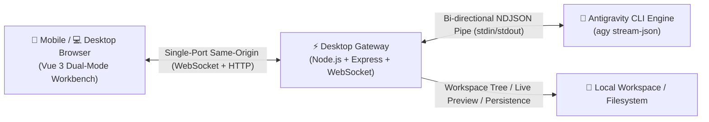

# Antigravity Web Remote Control Suite (IDEagy-Remote)

<p align="center">
  <a href="./README_EN.md"><b>English</b></a> | <a href="./README.md"><b>简体中文</b></a>
</p>

<p align="center">
  <a href="https://github.com/SimonChen-86/IDEagy-Remote/releases"></a>
  <a href="https://github.com/SimonChen-86/IDEagy-Remote/releases"></a>
  
  
  <a href="./LICENSE"></a>
  
</p>

---

A sleek, lightweight, cross-platform dual-mode Web Remote Control Workbench tailored for **Google Antigravity IDE**. Architected and developed by **Simon Chen**. With zero tedious configuration, developers can take full control of Antigravity AI programming from anywhere over LAN or WAN via mobile browser, tablet, or laptop Chrome — observing deep thinking chains, previewing deliverables in real time, and securely approving commands remotely.



UI & Live Preview:<br>


---

## 📖 Background

> *(Reserved section for user customization on GitHub)*

---

## 📥 Downloads & Quick Releases (GitHub Releases)

All cross-platform distribution packages are **ready-to-run portable green packages** (bundled with self-contained Node.js runtime, zero toolchain configuration required):

| Platform / OS | Download Link | Recommended Launch |
| :--- | :--- | :--- |
| **Windows (x64)** | [IDEagy-Remote-v0.1.10-windows-x64.zip](https://github.com/SimonChen-86/IDEagy-Remote/releases/latest) | Unzip and double-click `ideagy.bat` |
| **Linux (x64)** | [IDEagy-Remote-v0.1.10-linux-x64.tar.gz](https://github.com/SimonChen-86/IDEagy-Remote/releases/latest) | Unzip and run `./ideagy.sh` |
| **macOS (Apple Silicon)** | [IDEagy-Remote-v0.1.10-darwin-arm64.tar.gz](https://github.com/SimonChen-86/IDEagy-Remote/releases/latest) | Unzip and run `./ideagy.sh` |
| **Integrity Check** | [SHA256SUMS.txt](https://github.com/SimonChen-86/IDEagy-Remote/releases/latest) | `certutil -hashfile <file> SHA256` |

> 💡 **Usage Tip**: Please download the portable green packages from the table above for daily use. The `Source code` links automatically attached by GitHub at the bottom only contain documentation and manuals.

---

## ⚡ Quick Start Guide

Get started with remote Antigravity AI programming in just a few simple steps:

### 1. Launch the Gateway
- **Windows**: Double-click `ideagy.bat` (or its desktop shortcut) in the unzipped folder;
- **Linux / macOS**: Open terminal in the unzipped folder and execute `./ideagy.sh`.
- The terminal will display access details:
  ```text
  ================================================================
     🎉 Antigravity Web Remote Gateway is running!
  ================================================================
  📌 Local Access:   http://localhost:3000/
  🌐 LAN Access:     http://192.168.1.108:3000/
  🔒 Access Code:    antigravity  (Default password)
  ================================================================
  ```

### 2. Connect & Sign In
- Open the provided address (e.g., `http://192.168.1.108:3000/`) on your mobile, tablet, or laptop browser;
- Enter the default password `antigravity` to sign in (credentials are cached locally for 7 days).

### 3. Select Workspace & Converse with Agent
- **Select Workspace**: Choose from pinned workspaces or auto-detected recent Antigravity IDE active projects in the left panel;
- **Natural Interaction**: Enter your coding prompts in the bottom input bar or click handy quick action chips (e.g., [Check Bug], [Start Coding], [Continue]);
- **Thinking Chain**: Expand/collapse **ThinkingBox** to observe the agent's real-time reasoning and tool executions;
- **Live Preview**: Inspect modified source code, rendered Markdown, and interactive HTML sandboxes in the right panel (or mobile bottom drawer).

### 4. Seamless Dual-Mode Switching (📱 Mobile vs 💻 Desktop)
- Click the **Mode Switch Button** on the top right bar to toggle instantly:
  - **📱 Mobile Compact Mode (`< 768px`)**: Single-column thumb-friendly touch flow, chat stream, and slide-up preview drawer;
  - **💻 Desktop Workbench Mode (`>= 768px`)**: Professional 3-column IDE view (Workspace Navigation + Agent Chat + Multi-format Live Preview).

### 5. Preferences & Settings (⚙️ Settings)
- Click the **Settings Gear Icon** in the top or side bar:
  - **Change Password**: Customize your Web access control password;
  - **Model Configuration**: Switch backend AI models (e.g., `gemini-3.8-flash`) and adjust thinking effort levels;
  - **Quick Prompts**: Add, edit, or remove frequent prompt shortcuts.

---

## 🌟 Key Highlights

- **Pure Native Zero-Dependency (No Docker, No Database)**: Lightweight Node.js LTS runtime with zero Docker or SQL database requirements.
- **Same-Origin Single-Port Hosting**: Serves both Web static assets and full-duplex WebSocket channels on a single port (`3000`), completely eliminating CORS issues.
- **Dual-Mode Adaptive Workbench**: Seamlessly transitions between mobile one-hand touch flow and wide-screen 3-column desktop layout.
- **Multi-Format Live Preview Panel**: Integrated GFM Markdown rendering, isolated HTML sandboxes, syntax-highlighted code copy, and media viewing.
- **Smart Idle Sleep & Session Recovery**: Safely frees idle process resources after 20 minutes; click "Restore Last Session" to wake up agent memory instantly.

---

## 📚 Official Documentation

| Document | Core Topics | Direct Link |
| :--- | :--- | :---: |
| **📖 User Guide** | Password management, model setup, permission card approval, mobile guide & FAQ | [USER_GUIDE.md](./docs/USER_GUIDE.md) |
| **🚀 Deployment Guide** | Firewall & LAN pass, reverse proxy & HTTPS, public tunnel, auto-start on boot | [DEPLOYMENT_GUIDE.md](./docs/DEPLOYMENT_GUIDE.md) |

---

## 📄 License & Distribution

This project is released as **Freeware**. Only compiled releases and documentation are publicly distributed.

- **Free Usage**: Free for individual developers and teams for remote development and workbench interaction;
- **Proprietary Notice**: Source code remains closed-source with all rights reserved. Decompilation, reverse engineering, unauthorized repacking, or commercial resale is strictly prohibited;
- **Copyright**: Copyright (c) 2026 Simon Chen. All rights reserved.
