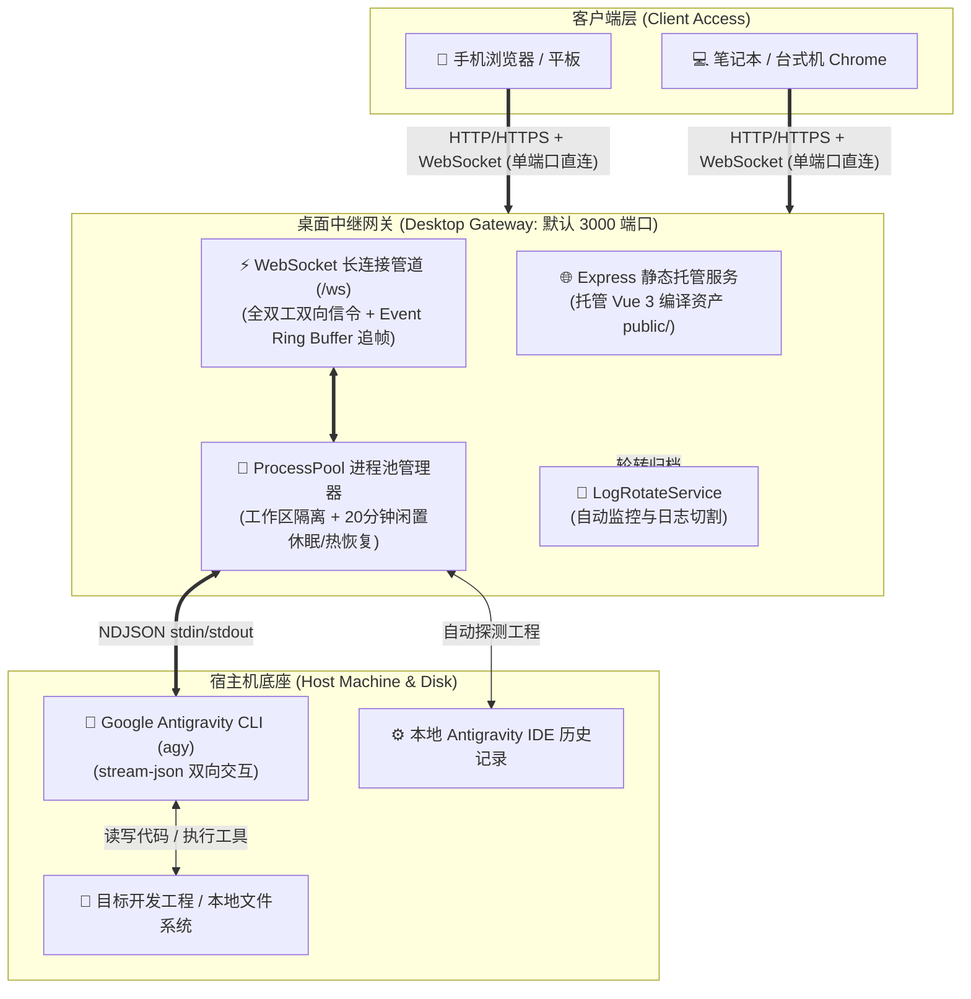

# Antigravity Web Remote 部署与运维实战指南

本文档全面介绍 **Antigravity Web Remote (IDEagy-Remote)** 的系统部署架构、软硬件环境准备、依赖组件清单、核心配置文件详析、三大操作系统原生启动管理、网络安全穿透以及生产级系统服务化（systemd 等）最佳实践。

---

## 📑 目录索引

1. [系统部署架构与设计哲学](#一系统部署架构与设计哲学)
2. [环境准备与依赖组件清单](#二环境准备与依赖组件清单)
3. [项目构建与向导式自动化部署 (deploy)](#三项目构建与向导式自动化部署-deploy)
4. [核心配置文件深度解析 (`gateway-config.json`)](#四核心配置文件深度解析-gateway-configjson)
5. [三大操作系统原生启动与运维管理](#五三大操作系统原生启动与运维管理)
6. [网络暴露与远程安全访问配置](#六网络暴露与远程安全访问配置)
7. [生产级系统服务化与开机自启 (System Daemon)](#七生产级系统服务化与开机自启-system-daemon)
8. [运维监控、日志轮转与故障排查清单 (Troubleshooting)](#八运维监控日志轮转与故障排查清单-troubleshooting)

---

## 一、系统部署架构与设计哲学

Antigravity Web Remote 采用 **“单端口同源一体化托管 (Same-Origin Hosting)”** 架构，将 Vue 3 SPA 静态前端产物与 Express + WebSocket 桌面网关融为一体：



### 核心设计哲学：
1. **纯原生零外部依赖 (No Heavy Daemon)**：彻底摆脱对 Docker 容器、Redis 缓存、MySQL/PostgreSQL 数据库或 IIS 服务器的繁重依赖。
2. **同源零跨域 (Zero CORS)**：单端口既提供静态页面又提供 WebSocket 管道，浏览器端直接基于 `location.host` 自动完成握手，杜绝跨域阻断与反向代理繁琐配置。
3. **安全自包含**：通过单一便携配置文件 `gateway-config.json` 即可管理全局策略。

---

## 二、环境准备与依赖组件清单

### 2.1 操作系统支持范围
系统具备高韧性的跨平台原生适配能力，支持以下主流操作系统：

| 操作系统类型 | 推荐版本 | 架构支持 | 专属启动器 |
| :--- | :--- | :--- | :---: |
| **Linux 发行版** | Ubuntu 20.04/22.04/24.04 LTS<br>Debian 11/12<br>CentOS 8+ / RHEL 8+ / Rocky Linux | x86_64 (amd64)<br>ARM64 (aarch64) | [`start-linux.sh`](../start-linux.sh) |
| **Apple macOS** | macOS 12 (Monterey) 及以上 | Apple Silicon (M1/M2/M3/M4)<br>Intel x86_64 | [`start-mac.sh`](../start-mac.sh) |
| **Microsoft Windows** | Windows 10 (1809+) / Windows 11<br>Windows Server 2019 / 2022 | x86_64 (amd64) | [`start-windows.bat`](../start-windows.bat) |

### 2.2 基础环境准备
1. **Node.js 运行时**：
   - 必需版本：**Node.js LTS v18.0.0+、v20.0.0+ 或 v22.0.0+**；
   - 验证命令：
     ```bash
     node -v
     npm -v
     ```
2. **Git 版本控制工具**：
   - 用于源码检出与工程目录环境探测；
   - 验证命令：`git --version`。
3. **Google Antigravity CLI 引擎 (`agy`)**：
   - Antigravity IDE 官方底层命令行工具；
   - 请确保已在宿主机终端中完成登录与初始化；
   - 验证命令：
     ```bash
     agy --version
     agy models
     ```
   - 若能正常列出模型列表（如 `gemini-3.8-flash` 等），则表明环境就绪。

### 2.3 依赖组件深度解析 (全部为纯 JS 绿色库)
本项目杜绝任何需要本地 C/C++ 编译器（如 `node-gyp`、`python2`、`make`、`gcc`）的原生二进制依赖，所有依赖均采用跨平台纯 JavaScript 实现：

#### 运行时依赖 (Runtime Dependencies)
- **`express` (^4.21.2)**：轻量级高性能 Web 路由，负责静态资产分发、健康检查与文件流 API；
- **`ws` (^8.18.0)**：高吞吐低延迟的纯 Node.js WebSocket 实现，承载客户端与网关的长连接通信；
- **`cross-spawn` (^7.0.6)**：跨平台进程生成器，解决 Windows (`agy.cmd`) 与 POSIX (`agy`) 进程启动与环境变量传递差异；
- **`vue` (^3.5.13)**：响应式前端界面核心引擎；
- **`lucide-vue-next` (^0.475.0)**：现代化扁平化矢量图标集；
- **`markdown-it` (^14.1.0)**：高性能纯 JS Markdown 渲染器；
- **`mermaid` (^11.17.2)**：客户端纯 JS 架构流程图渲染引擎。

#### 开发与构建工具 (Build Tooling)
- **`typescript` (^5.7.3)**：类型检查与类型安全保障；
- **`vite` (^6.1.1)**：超高速前端打包工具；
- **`tsx` (^4.19.3)**：TypeScript 原生执行器，用于网关快速热加载开发。

---

## 三、项目构建与向导式自动化部署 (deploy)

系统提供了两种构建与部署方式：
1. **推荐：跨平台向导式独立部署工具 (`deploy`)**：自动检测环境、拉取依赖、全量编译，并分发生成自包含的独立生产运行包（如 `~/AgyRemote` 或 `C:\AgyRemote`），根据系统严格裁剪专属启动脚本，适合生产投产与开箱即用；
2. **源码内手动构建与原地启动**：适合开发者在当前工程源码树中编译调试。

### 3.1 方式一：向导式独立部署工具 (推荐)

在项目根目录下直接运行对应平台的部署向导：

- **Linux / macOS**:
  ```bash
  ./deploy.sh
  ```
- **Windows**:
  ```cmd
  deploy-windows.bat
  ```

#### 部署向导核心行为机制：
1. **环境与引擎自适应检测**：
   - 自动检测 Node.js（推荐 18+）与 npm 工具链；
   - 探测 Antigravity IDE 与 CLI (`agy`) 状态。若未检测到，提示官方下载指引（`https://antigravity.google/download`），支持弱拦截（用户输入 `y` 即可跳过继续）；
2. **确认拉取依赖与全量构建**：
   - 自动执行 `npm install` 与 `npm run build`，编译生成前端 SPA 与后端 Gateway 产物；
3. **部署路径决策与安全更新**：
   - 默认安装路径：Linux / macOS 为 `~/AgyRemote`，Windows 为 `C:\AgyRemote`，支持自定义输入；
   - 若目标目录已存在，向导提供三个安全选项：
     - `[1] 保留原配置并覆盖更新`（保留 `gateway-config.json` 中的密码与端口等自定义配置）；
     - `[2] 彻底全新覆盖安装`；
     - `[3] 重新指定新的安装路径`。
4. **纯净打包与平台专属脚本裁剪**：
   - 拷贝生产静态资产、编译产物、生产依赖与操作文档；
   - **严格输出专属优化启动脚本**：Linux 目标目录仅保留 `start-linux.sh`；macOS 目标目录仅保留 `start-mac.sh`；Windows 目标目录保留 `start-windows.bat` 与 `start-windows.sh`（供 Git Bash 使用），彻底剔除无关系统的多余文件；
5. **访问密码设置与交付指引**：
   - 交互提示设置 Web 控制台密码（回车保持默认 `antigravity`）；
   - 输出完整的安装目录路径、启动命令与用户手册文件名（`docs/USER_GUIDE.md`）。

---

### 3.2 方式二：源码内手动构建与原地启动

若您希望直接在当前源码目录中执行构建与运行：

1. **获取项目代码与安装依赖**：
   ```bash
   npm install
   ```
2. **一键全量生产构建**：
   ```bash
   npm run build
   ```
   构建完成后，生成的核心产物位于：
   - `packages/web-remote/dist/` -> 同步注入至 `packages/desktop-gateway/public/`（前端静态资产）
   - `packages/desktop-gateway/dist/`（中继网关编译后的 JS 文件）
3. **在源码目录启动**：
   - Linux: `./start-linux.sh start`
   - macOS: `./start-mac.sh start`
   - Windows: `start-windows.bat start`

---

## 四、核心配置文件深度解析 (`gateway-config.json`)

系统在根目录下提供唯一的配置文件 [`gateway-config.json`](../gateway-config.json)，启动器会在启动时自动读取并热同步。

### 完整配置项与生产推荐值：

```json
{
  "server": {
    "host": "0.0.0.0",
    "port": 3000,
    "password": "antigravity",
    "sessionDurationDays": 7,
    "ssl": {
      "enabled": false,
      "cert": "",
      "key": ""
    }
  },
  "agent": {
    "executable": "agy",
    "idleTimeoutMinutes": 20,
    "permissionTimeoutSeconds": 180,
    "permissionMode": "always_proceed",
    "defaultModel": "gemini-3.8-flash",
    "defaultEffort": "high",
    "turnTimeout": "30m"
  },
  "logging": {
    "maxSizeBytes": 20971520,
    "maxBackups": 2,
    "maxAgeDays": 7,
    "checkIntervalMinutes": 30
  },
  "workspaces": [],
  "pinnedWorkspaces": [],
  "preferences": {
    "quickPrompts": [
      { "icon": "🔍", "label": "查Bug", "prompt": "请排查当前工程中潜在的Bug与逻辑漏洞，并提出修改建议。" },
      { "icon": "💡", "label": "模型确认", "prompt": "请返回显示目前你使用的 模型名称 和 思考等级" },
      { "icon": "🚀", "label": "开始编码", "prompt": "开始编码" },
      { "icon": "🚀", "label": "继续", "prompt": "继续" }
    ]
  }
}
```

### 字段说明表：

| 配置字段 | 类型 | 默认值 | 详细作用与调优建议 |
| :--- | :--- | :--- | :--- |
| **`server.host`** | string | `"0.0.0.0"` | 监听地址。`0.0.0.0` 允许本机、局域网及公网通过网卡访问；若仅允许本机使用可设为 `127.0.0.1`。 |
| **`server.port`** | number | `3000` | HTTP 与 WebSocket 统一服务端口。若遇端口冲突可通过启动脚本自由更换。 |
| **`server.password`** | string | `"antigravity"` | **工作台统一访问密码**。生产环境建议修改为高强度自定义密码。 |
| **`server.sessionDurationDays`** | number | `7` | 免登凭证的保留天数。设为 `7` 表示用户登录一次后 7 天内无须重新输入密码。 |
| **`server.ssl.enabled`** | boolean | `false` | 是否开启原生 HTTPS / WSS 协议。设为 `true` 时需填入下方 cert 与 key 绝对路径。 |
| **`server.ssl.cert`** | string | `""` | SSL 证书文件绝对路径（如 `/etc/ssl/certs/fullchain.pem`）。 |
| **`server.ssl.key`** | string | `""` | SSL 证书私钥文件绝对路径（如 `/etc/ssl/private/privkey.pem`）。 |
| **`agent.executable`** | string | `"agy"` | 底层 Antigravity CLI 可执行文件名或绝对路径。 |
| **`agent.idleTimeoutMinutes`** | number | `20` | 工作区子进程闲置自动休眠时长（分钟）。超时无交互自动释放子进程内存，唤醒时热恢复。 |
| **`agent.permissionTimeoutSeconds`** | number | `180` | 高危操作权限卡片等待审批超时时长（秒）。超时后自动执行安全熔断并拒绝操作。 |
| **`agent.permissionMode`** | string | `"always_proceed"` | 权限模式。可选：`always_proceed`（自主模式）或 `request_review`（严格拦截模式）。 |
| **`agent.defaultModel`** | string | `"gemini-3.8-flash"`| 默认选用的模型。 |
| **`agent.defaultEffort`** | string | `"high"` | Gemini 默认思考深度。可选：`"low"`, `"medium"`, `"high"`。 |
| **`agent.turnTimeout`** | string | `"30m"` | 单轮交互全局超时熔断时长。 |
| **`logging.maxSizeBytes`** | number | `20971520` | 单个日志文件最大尺寸（字节，默认 20MB）。超过后自动触发日志轮转。 |
| **`logging.maxBackups`** | number | `2` | 日志备份归档保留份数。超期后自动清除旧归档。 |
| **`logging.maxAgeDays`** | number | `7` | 日志文件最长保留天数。 |
| **`pinnedWorkspaces`** | array | `[]` | 常用置顶工程列表。可通过 Web 端设置面板进行增删。 |
| **`preferences.quickPrompts`**| array | `[...]` | 快捷指令库。可在 Web 端自由自定义。 |

---

## 五、三大操作系统原生启动与运维管理

针对不同操作系统的进程管理与环境特性，项目提供了专属优化启动器，均支持 **“交互式控制台菜单”** 与 **“命令行直接传参”** 双重模式。

### 5.1 Linux / Ubuntu 环境运维 (`start-linux.sh`)

#### 方式 1：交互式控制台模式（推荐）
在终端中直接执行：
```bash
./start-linux.sh
```
将进入科技感交互菜单：
```text
=========================================================
  🚀 Antigravity IDE Web Remote 控制台管理器 [Linux 专用版]
=========================================================
  ● 当前服务状态: [ 运行中 ] (PID: 284192, Port: 3000)
---------------------------------------------------------
  [1] 启动网关服务 (Start Gateway)
  [2] 停止网关服务 (Stop Gateway)
  [3] 重启网关服务 (Restart Gateway)
  [4] 查看运行状态 (Check Status)
  [5] 实时查看日志 (Tail Log)
  [6] 更换服务端口 (Change Port)
  [0] 退出管理菜单 (Exit)
=========================================================
```

#### 方式 2：命令行直接传参模式（适合脚本与 CI/CD）
```bash
./start-linux.sh start           # 后台启动服务
./start-linux.sh stop            # 安全停止服务
./start-linux.sh restart         # 平滑重启服务
./start-linux.sh status          # 检查服务健康状态与端口占用
./start-linux.sh port 8080       # 一键将端口修改为 8080 并重启生效
```

#### 技术特性说明：
- **POSIX 原生常驻守护**：使用 `nohup node ... > /dev/null 2>&1 &` 启动后台常驻，断开 SSH 终端连接后服务持续稳定运行；
- **精确 PID 查杀**：自动维护 `.gateway.pid`，停止与重启时精准关闭目标进程，坚决不误杀其他 Node.js 服务；
- **静默免刷屏**：控制台不会被密集日志淹没，详细日志由后台服务重定向输出至 `.gateway.log`。

---

### 5.2 Apple macOS 环境运维 (`start-mac.sh`)

macOS 终端经常存在由于 GUI 启动未注入 `/opt/homebrew/bin` 导致找不到 `node` 或 `agy` 的顽疾。`start-mac.sh` 针对此问题进行了深度加固：

```bash
./start-mac.sh
```
或使用直接传参：
```bash
./start-mac.sh start
./start-mac.sh stop
./start-mac.sh restart
./start-mac.sh status
```

#### 技术特性说明：
- **PATH 环境变量自动补齐**：启动前自动扫描 `/opt/homebrew/bin`、`/usr/local/bin` 以及 `$(npm prefix -g)/bin`，全自动注入当前 Shell 会话；
- **原生局域网 IP 嗅探**：使用 macOS 原生 `ipconfig getifaddr en0`（或 `en1`）精准提取活跃局域网 IP，避免输出无效虚拟网卡地址。

---

### 5.3 Windows 10 / 11 / Server 环境运维 (`start-windows.bat`)

Windows 环境下双击运行或在 CMD/PowerShell 中执行：
```cmd
start-windows.bat
```
直接传参支持：
```cmd
start-windows.bat start
start-windows.bat stop
start-windows.bat restart
start-windows.bat status
start-windows.bat port 8080
```

#### 技术特性说明：
- **UTF-8 代码页强制注入**：启动即执行 `chcp 65001 >nul` 与 `set PYTHONIOENCODING=utf-8`，彻底解决 Windows 终端与日志中的中文路径乱码问题；
- **双重校验防误杀**：基于 `.gateway.pid` 与映像名称 `node.exe` 双重比对关闭进程，杜绝粗暴扫描端口误杀其他开发服务。

---

## 六、网络暴露与远程安全访问配置

### 6.1 方案 A：局域网直接访问 (Wi-Fi / 内网办公)
如果您在同一 Wi-Fi 或公司内网中访问开发机，仅需确保开发机防火墙放行了配置的端口（默认 `3000`）。

#### 1. Linux (UFW 防火墙)：
```bash
sudo ufw allow 3000/tcp
sudo ufw reload
```

#### 2. Linux (CentOS / RHEL firewalld)：
```bash
sudo firewall-cmd --zone=public --add-port=3000/tcp --permanent
sudo firewall-cmd --reload
```

#### 3. Windows 防火墙：
在管理员 PowerShell 中执行：
```powershell
New-NetFirewallRule -DisplayName "Antigravity Remote" -Direction Inbound -LocalPort 3000 -Protocol TCP -Action Allow
```

---

### 6.2 方案 B：自建 Nginx / Caddy 反向代理与 HTTPS 配置
为了获得更严格的移动端 PWA 离线体验或通过标准 `80/443` 域名访问，推荐使用 Nginx 或 Caddy 进行反向代理。

#### Nginx 生产级配置模板 (`/etc/nginx/conf.d/antigravity.conf`)：
```nginx
# 定义上游网关
upstream ideagy_backend {
    server 127.0.0.1:3000;
    keepalive 32;
}

server {
    listen 80;
    server_name remote.yourdomain.com;
    # 强制将 HTTP 重定向至 HTTPS
    return 301 https://$host$request_uri;
}

server {
    listen 443 ssl http2;
    server_name remote.yourdomain.com;

    # SSL 证书配置
    ssl_certificate     /etc/letsencrypt/live/remote.yourdomain.com/fullchain.pem;
    ssl_certificate_key /etc/letsencrypt/live/remote.yourdomain.com/privkey.pem;
    ssl_protocols TLSv1.2 TLSv1.3;
    ssl_ciphers HIGH:!aNULL:!MD5;

    # 客户端上传文件大小限制
    client_max_body_size 100M;

    location / {
        proxy_pass http://ideagy_backend;
        
        # 基础 Proxy Headers
        proxy_set_header Host $host;
        proxy_set_header X-Real-IP $remote_addr;
        proxy_set_header X-Forwarded-For $proxy_add_x_forwarded_for;
        proxy_set_header X-Forwarded-Proto $scheme;

        # 核心：WebSocket 全双工升级协议转发配置
        proxy_http_version 1.1;
        proxy_set_header Upgrade $http_upgrade;
        proxy_set_header Connection "upgrade";

        # 超时设置：防止长时间无信令导致长连接被 Nginx 断开
        proxy_read_timeout 86400s;
        proxy_send_timeout 86400s;
    }
}
```

#### Caddy 极简配置模板 (`Caddyfile`)：
```caddy
remote.yourdomain.com {
    reverse_proxy 127.0.0.1:3000
}
```
> Caddy 将自动申请并配置 Let's Encrypt 免费 SSL 证书，并原生支持 WebSocket 升级透传。

---

### 6.3 方案 C：公网安全内网穿透方案 (强烈推荐 Tailscale)
若开发机无公网独立 IP，且不希望将端口暴露在公网上，建议采用现代虚拟局域网或零信任方案：

#### 推荐方案 1：Tailscale (零配置、安全加密)
1. 在开发机上安装 Tailscale 并登录：
   ```bash
   curl -fsSL https://tailscale.com/install.sh | sh
   sudo tailscale up
   ```
2. 在手机或笔记本上安装 Tailscale 客户端并登录同一账号；
3. 开发机将分配一个虚拟内网 IP（如 `100.x.y.z`）；
4. 手机或笔记本浏览器直接打开 `http://100.x.y.z:3000/`，享受点对点端到端 WireGuard 加密通信。

#### 推荐方案 2：Cloudflare Tunnel (零信任公开访问)
1. 在开发机运行 `cloudflared`：
   ```bash
   cloudflared tunnel --url http://localhost:3000
   ```
2. Cloudflare 将返回一个安全公共 HTTPS 域名，开箱即用，无需配置路由器端口转发。

---

## 七、生产级系统服务化与开机自启 (System Daemon)

若希望开发机重启后服务全自动恢复，可配置操作系统级服务。

### 7.1 Linux systemd 服务化配置
1. 创建服务单元定义文件：
   ```bash
   sudo nano /etc/systemd/system/antigravity-remote.service
   ```
2. 写入如下配置（请将其中的路径和用户名替换为您的实际环境）：
   ```ini
   [Unit]
   Description=Antigravity IDE Web Remote Gateway
   After=network.target

   [Service]
   Type=simple
   User=your_username
   WorkingDirectory=/home/your_username/IDEagy-Remote
   Environment=NODE_ENV=production
   Environment=LANG=zh_CN.UTF-8
   Environment=LC_ALL=zh_CN.UTF-8
   ExecStart=/usr/bin/node packages/desktop-gateway/dist/index.js
   Restart=always
   RestartSec=5s
   StandardOutput=append:/home/your_username/IDEagy-Remote/.gateway.log
   StandardError=append:/home/your_username/IDEagy-Remote/.gateway.log

   # 资源限制
   LimitNOFILE=65535

   [Install]
   WantedBy=multi-user.target
   ```
3. 激活并启动服务：
   ```bash
   sudo systemctl daemon-reload
   sudo systemctl enable antigravity-remote
   sudo systemctl start antigravity-remote
   ```
4. 检查服务状态：
   ```bash
   sudo systemctl status antigravity-remote
   ```

---

## 八、运维监控、日志轮转与故障排查清单 (Troubleshooting)

### 8.1 日志轮转与健康监控
- 网关内置了 **`LogRotateService`** 守护机制；
- 运行日志持续写入项目根目录下的 [`.gateway.log`](../.gateway.log)；
- 当日志尺寸达到 `logging.maxSizeBytes`（默认 20MB）时，系统自动执行原子切割重命名并归档；
- 超过 `logging.maxBackups`（默认 2 份）或超过 `logging.maxAgeDays`（默认 7 天）的归档文件将自动清理，确保磁盘永不被占满。

实时追踪日志命令：
```bash
tail -f .gateway.log
```

---

### 8.2 故障排查清单 (Troubleshooting)

#### 故障 1：启动报错 `agy: command not found` 或模型探测为空
- **原因**：Antigravity CLI 命令行工具未安装或其所在路径未包含在系统全局 `PATH` 中。
- **解决办法**：
  1. 在终端执行 `which agy` 确认安装位置；
  2. 若已安装但在当前用户 PATH 下找不到，请在 `~/.bashrc` 或 `~/.zshrc` 中导出路径：
     ```bash
     export PATH="$HOME/.local/bin:$PATH"
     ```
  3. 或者直接在 [`gateway-config.json`](../gateway-config.json) 中将 `"agent.executable"` 修改为 `agy` 的绝对路径（如 `"/usr/local/bin/agy"`）。

#### 故障 2：启动提示端口已被占用 (`EADDRINUSE: address already in use :::3000`)
- **原因**：端口 3000 已被旧实例或其他服务占用。
- **解决办法**：
  1. 使用专属启动脚本直接换端口启动：
     ```bash
     ./start-linux.sh port 3001
     ```
  2. 或者手动查找并关闭占用端口的残留进程：
     ```bash
     lsof -i :3000 | awk 'NR>1 {print $2}' | xargs kill -9
     ```

#### 故障 3：手机无法连接开发机
- **原因**：防火墙阻断、网络不通或 IP 填写错误。
- **排查步骤**：
  1. 手机端浏览器打开前，确认手机与电脑连接的是同一个 Wi-Fi 热点；
  2. 确认在手机上输入的不是 `http://localhost:3000/`，而是开发机的真实局域网 IP（如 `http://192.168.1.108:3000/`）；
  3. 检查开发机防火墙（参考本文第 6.1 节执行放行命令）。

#### 故障 4：忘记登录密码或被恶意篡改
- **解决办法**：
  1. 在开发机本地打开 [`gateway-config.json`](../gateway-config.json)；
  2. 找到 `"server"` 节点的 `"password"` 项，直接重置为您的新密码（如 `"my_new_password"`）；
  3. 执行 `./start-linux.sh restart` 即可完成热加载与更新。

#### 故障 5：终端或中文日志显示 `???` 乱码
- **原因**：宿主机终端字符集未声明为 UTF-8。
- **解决办法**：
  1. 专属启动器 `start-linux.sh` / `start-mac.sh` / `start-windows.bat` 内部均已内嵌全量 UTF-8 注入逻辑；
  2. 请始终优先通过官方专属启动器管理网关，即可确保编码一致性。
